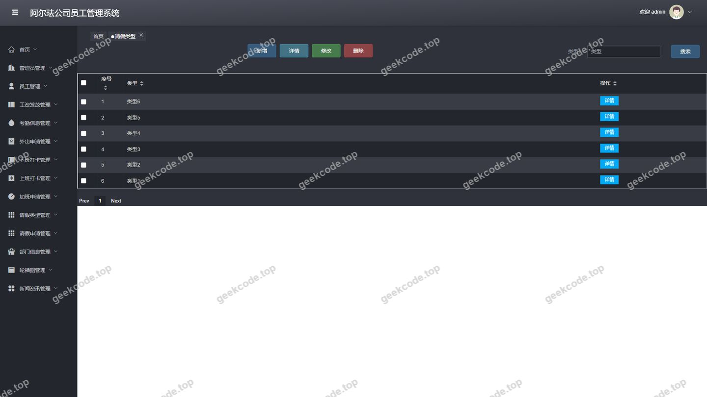
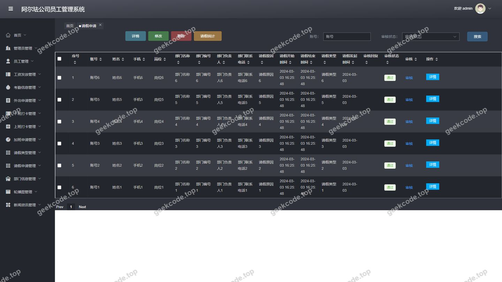
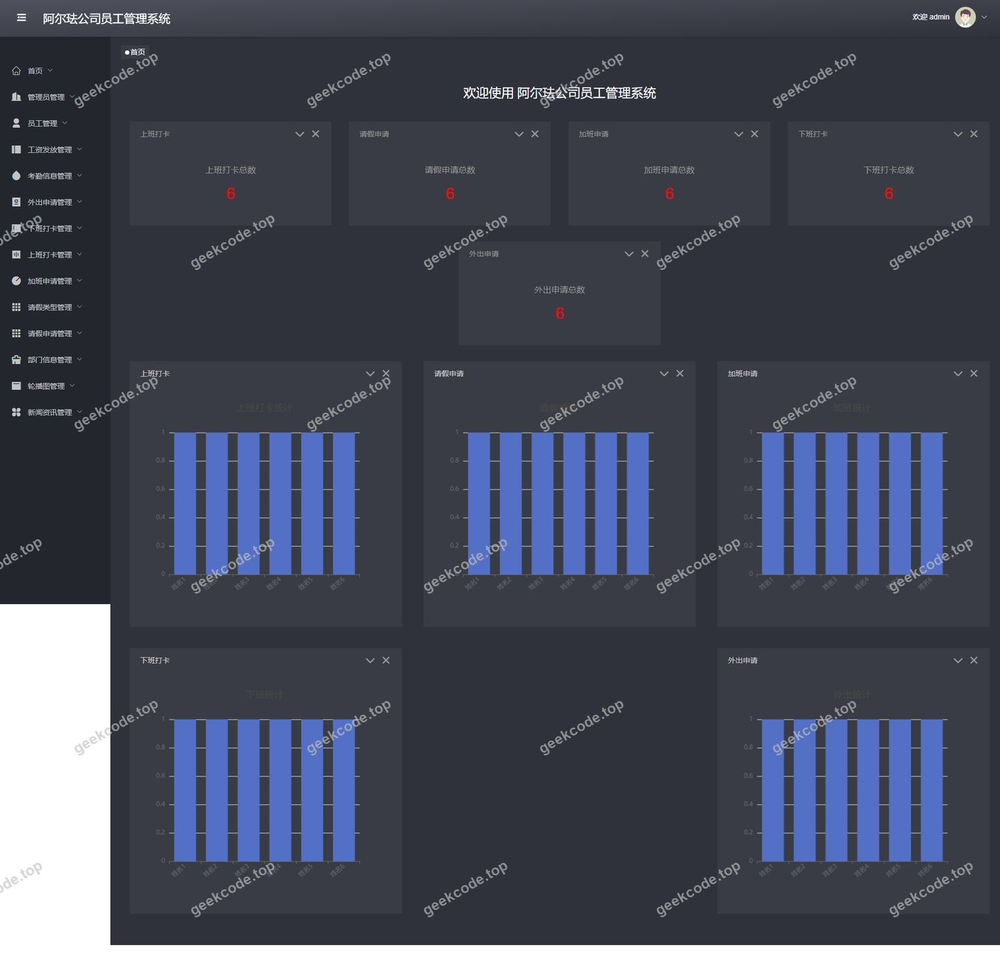
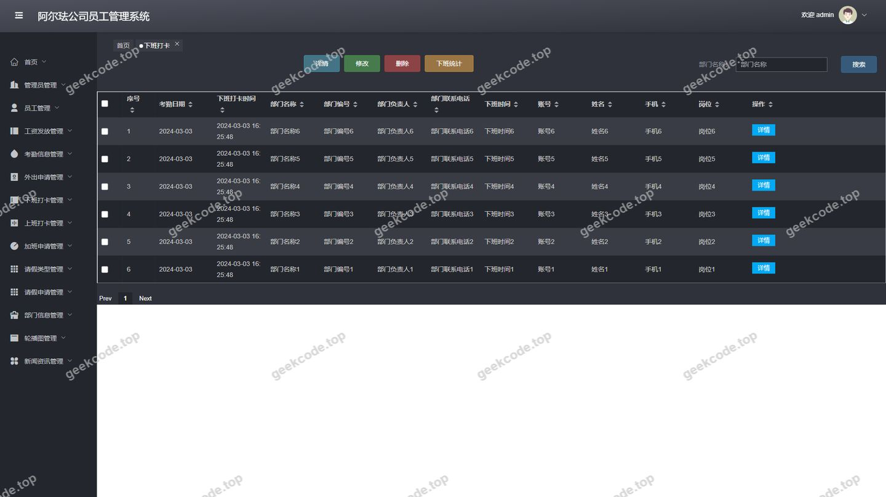
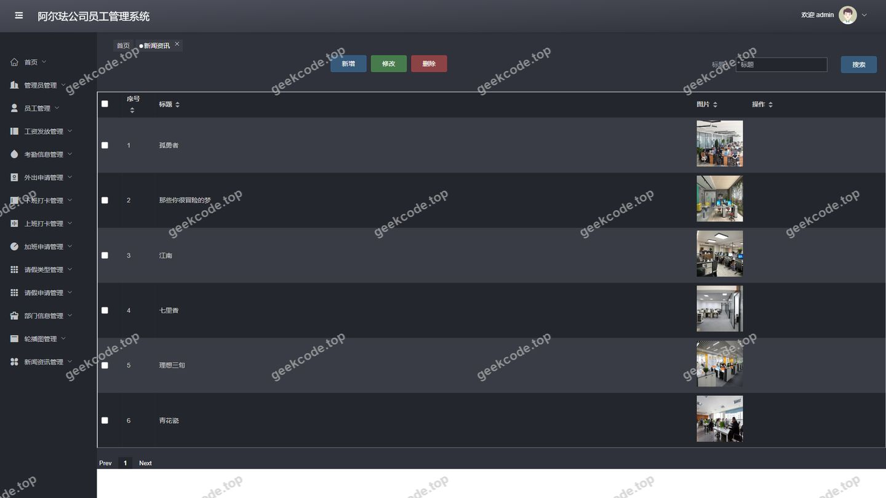
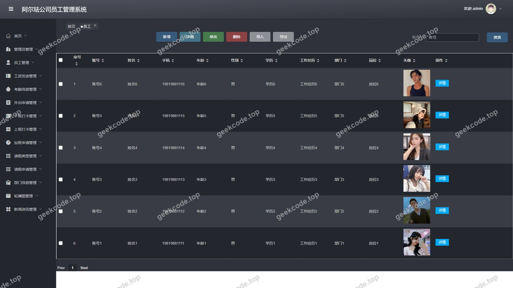

# [springboot]阿尔珐公司员工管理系统

> 🎓 **计算机毕业设计 · [springboot]阿尔珐公司员工管理系统**
>
> 本仓库只放**项目介绍 + 运行截图**（截图是站点带水印的原图，存在仓库 `images/` 里）。
>
> 👉 **完整可运行源码 / 数据库脚本 / 部署文档：[点我获取](https://geekcode.top/archives/springboot-%E9%98%BF%E5%B0%94%E7%8F%90%E5%85%AC%E5%8F%B8%E5%91%98%E5%B7%A5%E7%AE%A1%E7%90%86%E7%B3%BB%E7%BB%9F?utm_source=github)**
>
> 💬 咨询微信：**ir9372**　|　🌐 更多项目：[极客代码 geekcode.top](https://geekcode.top/?utm_source=github)
>
> 📌 项目详情页：<https://geekcode.top/archives/springboot-%E9%98%BF%E5%B0%94%E7%8F%90%E5%85%AC%E5%8F%B8%E5%91%98%E5%B7%A5%E7%AE%A1%E7%90%86%E7%B3%BB%E7%BB%9F?utm_source=github>

<table><td width="230" align="center"> <b>扫码加微信 ir9372</b></td><td valign="middle">📦 源码 = 项目介绍 + 全部运行截图 + 数据库 + 部署文档 👉 点上方任意截图，直接跳到 <b>极客代码 geekcode.top</b> 详情页</td></table>

---

<h1>[springboot]阿尔珐公司员工管理系统</h1>
<h2>项目概述</h2>

阿尔珐公司员工管理系统是一款基于 Spring Boot 与 Vue 前后端分离架构的企业级人力资源管理平台。该项目旨在解决传统纸质或简单电子表格在员工考勤、请假审批及薪资发放管理中存在的效率低下、数据孤岛及权限混乱问题。系统核心功能涵盖员工信息管理、部门组织架构维护、多维度考勤打卡（上班/下班）、请假与加班申请审批、外出申请管理及工资发放记录等模块。适用人群包括企业人力资源专员、部门管理者及普通员工。技术架构上，后端采用 Spring Boot 结合 MyBatis-Plus 实现高效数据持久化，使用 Apache Shiro 进行安全认证与授权；前端基于 Vue.js 构建响应式界面，实现了前台用户自助服务与后台管理员集中管控的双端协同，显著提升了企业内部行政管理的数字化水平。

<h2>技术架构</h2>

本项目采用经典的前后端分离架构模式，确保了系统的可维护性与扩展性。

<strong>后端架构：</strong>
核心框架选用 Spring Boot，利用其自动配置特性简化开发流程。数据访问层采用 MyBatis-Plus，通过继承通用 Mapper 接口大幅减少 CRUD 代码冗余，提升开发效率。安全框架集成 Apache Shiro，负责处理用户身份认证（Authentication）与授权（Authorization），确保不同角色只能访问受保护的资源。数据库连接使用 MySQL Connector Java，配合 Spring JDBC Starter 实现事务管理。

<strong>前端架构：</strong>
前端采用 Vue.js 框架（vue-separate 模式），通过 Axios 异步请求与后端 RESTful API 交互。路由管理区分前台用户视图（如 <code>/index/yuangongList</code>）与后台管理视图（如 <code>/yuangong</code>, <code>/qingjiashenqing</code>），实现页面组件的按需加载与状态隔离。

<strong>核心技术选型理由：</strong>

<ol>
<li><strong>Spring Boot + MyBatis-Plus</strong>：相比原生 MyBatis，MyBatis-Plus 提供了更便捷的单表操作和条件构造器，适合业务逻辑相对标准化的管理系统。</li>
<li><strong>Shiro</strong>：相较于 Spring Security，Shiro 配置更轻量，易于理解，非常适合中小型单体应用的权限控制需求。</li>
<li><strong>Vue.js</strong>：双向数据绑定机制使得表单录入（如请假申请、员工信息修改）更加直观高效，用户体验优于传统 JSP 模板渲染。</li>
</ol>
<h2>功能模块</h2>

根据源码路由配置及截图所示，系统功能划分为前台用户端与后台管理端两大板块。

<h3>前台用户端</h3>

前台主要面向普通员工，提供自助查询与信息提交功能：

<ul>
<li><strong>员工中心 (<code>/index/yuangongCenter</code>)</strong>：查看个人基本信息及状态。</li>
<li><strong>员工列表与详情 (<code>/index/yuangongList</code>, <code>/index/yuangongDetail</code>)</strong>：浏览公司公开的员工名录及详细档案。</li>
<li><strong>部门信息 (<code>/index/bumenxinxiList</code>, <code>/index/bumenxinxiDetail</code>, <code>/index/bumenxinxiAdd</code>)</strong>：查看部门架构，支持特定条件下的部门信息新增。</li>
<li><strong>考勤打卡 (<code>/index/shangbandaka...</code>, <code>/index/xiabandaka...</code>)</strong>：包含上班打卡与下班打卡的记录查询、详情查看及新增提交功能。</li>
<li><strong>假期管理 (<code>/index/qingjialeixing...</code>, <code>/index/qingjiashenqing...</code>)</strong>：查看请假类型定义，发起请假申请，查询申请进度及详情。</li>
<li><strong>加班与外出 (<code>/index/jiabanshenqing...</code>, <code>/index/waichushenqing...</code>)</strong>：提交加班申请与外出申请，并查看相关历史记录。</li>
<li><strong>考勤信息汇总 (<code>/index/kaoqinxinxi...</code>)</strong>：查看个人的综合考勤统计数据。</li>
<li><strong>工资发放 (<code>/index/gongzifafangList</code>, <code>/index/gongzifafangDetail</code>)</strong>：查询个人工资发放明细及历史记录。</li>
<li><strong>新闻资讯 (<code>/news</code>)</strong>：虽然主要在后台管理，但通常作为公告栏在前台展示公司动态。</li>
</ul>
<h3>后台管理端</h3>

后台面向管理员，提供全量数据的增删改查及配置管理：

<ul>
<li><strong>员工管理 (<code>/yuangong</code>)</strong>：对全体员工档案进行统一维护。</li>
<li><strong>部门管理 (<code>/bumenxinxi</code>)</strong>：维护公司组织架构树。</li>
<li><strong>考勤管理 (<code>/shangbandaka</code>, <code>/xiabandaka</code>, <code>/kaoqinxinxi</code>)</strong>：审核与管理所有员工的上下班打卡记录及最终考勤结果。</li>
<li><strong>审批管理 (<code>/qingjiashenqing</code>, <code>/jiabanshenqing</code>, <code>/waichushenqing</code>)</strong>：处理员工提交的请假、加班及外出申请，执行批准或驳回操作。</li>
<li><strong>基础配置 (<code>/qingjialeixing</code>, <code>/config</code>)</strong>：定义请假类型规则及系统全局参数配置。</li>
<li><strong>薪酬管理 (<code>/gongzifafang</code>)</strong>：生成并管理所有员工的工资发放记录。</li>
<li><strong>内容管理 (<code>/news</code>)</strong>：发布和管理公司新闻资讯。</li>
<li><strong>用户权限管理 (<code>/users</code>)</strong>：管理系统登录账号及角色分配。</li>
</ul>
<h2>用户角色与权限</h2>

基于 Shiro 框架及路由隔离设计，系统主要存在两类角色：管理员与普通员工。

<strong>1. 管理员 (Admin)</strong>

<ul>
<li><strong>权限范围</strong>：拥有最高系统权限，可访问所有后台路由。</li>
<li><strong>具体功能</strong>：</li>
<li><strong>全面数据管理</strong>：可对 <code>/yuangong</code>（员工）、<code>/bumenxinxi</code>（部门）、<code>/users</code>（系统用户）进行增删改查。</li>
<li><strong>审批权</strong>：拥有对 <code>/qingjiashenqing</code>（请假）、<code>/jiabanshenqing</code>（加班）、<code>/waichushenqing</code>（外出）申请的最终审批权限。</li>
<li><strong>薪酬与考勤核定</strong>：负责 <code>/gongzifafang</code>（工资发放）的数据录入与 <code>/kaoqinxinxi</code>（考勤信息）的最终确认。</li>
<li><strong>系统配置</strong>：可编辑 <code>/qingjialeixing</code>（请假类型）及 <code>/config</code>（系统设置）。</li>
<li><strong>信息发布</strong>：管理 <code>/news</code>（新闻资讯）。</li>
</ul>

<strong>2. 普通员工 (User)</strong>

<ul>
<li><strong>权限范围</strong>：仅能访问前台 <code>/index/*</code> 路由下的部分功能，且数据可见性受限（通常仅看自己或公开信息）。</li>
<li><strong>具体功能</strong>：</li>
<li><strong>自助服务</strong>：通过 <code>/index/yuangongCenter</code> 查看个人信息。</li>
<li><strong>业务发起</strong>：通过 <code>/index/qingjiashenqingAdd</code>、<code>/index/jiabanshenqingAdd</code> 等路径提交各类申请。</li>
<li><strong>日常打卡</strong>：通过 <code>/index/shangbandakaAdd</code> 和 <code>/index/xiabandakaAdd</code> 完成每日考勤动作。</li>
<li><strong>信息查询</strong>：查看 <code>/index/gongzifafangList</code> 了解自身薪资情况，查看 <code>/index/kaoqinxinxiList</code> 了解自身考勤统计。</li>
<li><strong>受限操作</strong>：无法进入后台管理界面，无法修改他人数据或系统配置。</li>
</ul>
<h2>项目特色与创新点</h2>
<ol>
<li><strong>全流程闭环管理</strong>：系统覆盖了从“入职建档”到“日常考勤”，再到“异常申请（请假/加班/外出）”，最后至“薪资结算”的完整 HR 业务链条，消除了线下纸质单据流转的繁琐。</li>
<li><strong>细粒度的权限控制</strong>：利用 Shiro 实现了前后台物理隔离与逻辑隔离。后台专注于宏观管理与审批，前台专注于微观执行与查询，既保证了数据安全，又提升了操作便捷性。</li>
<li><strong>灵活的考勤规则引擎</strong>：通过 <code>/qingjialeixing</code>（请假类型）的配置化管理，系统能够适应不同企业对病假、事假、年假等不同假期的差异化计算规则，无需修改代码即可调整业务逻辑。</li>
<li><strong>数据可视化与追溯</strong>：每个业务模块均包含 <code>List</code>（列表）、<code>Detail</code>（详情）、<code>Add</code>（新增）的标准三态路由，确保了数据的可追溯性。例如，员工可以清晰看到每一次打卡的具体时间点以及对应的考勤汇总结果，减少了劳资纠纷中的举证难度。</li>
</ol>
<h2>部署环境</h2>

为确保系统正常运行，需准备以下软硬件环境：

<strong>1. 硬件要求</strong>

<ul>
<li>CPU: Intel Core i5 及以上或同等性能处理器。</li>
<li>内存: 8GB RAM 及以上（推荐 16GB 以优化 JVM 运行效率）。</li>
<li>硬盘: 至少 50GB 可用空间（用于存储操作系统、数据库文件及日志）。</li>
</ul>

<strong>2. 软件环境</strong>

<ul>
<li><strong>JDK</strong>: Java Development Kit 1.8 或更高版本（Spring Boot 2.x 系列兼容 JDK 8+）。</li>
<li><strong>MySQL</strong>: 数据库版本 5.7 或 8.0，需启用 InnoDB 存储引擎以支持事务。</li>
<li><strong>Maven</strong>: 版本 3.6+，用于后端依赖管理与项目构建。</li>
<li><strong>Node.js</strong>: 版本 12 LTS 或 14 LTS，用于前端 Vue 项目的依赖安装（npm/yarn）及打包构建。</li>
<li><strong>IDE</strong>: IntelliJ IDEA 或 Eclipse（用于后端开发），VS Code（用于前端开发）。</li>
<li><strong>浏览器</strong>: Chrome, Firefox, Edge 等现代主流浏览器。</li>
</ul>

<strong>3. 网络环境</strong>

<ul>
<li>服务器需开放默认端口（通常为 8080 用于后端服务，80/443 用于 Nginx 代理前端静态资源）。</li>
<li>若为内网部署，需确保客户端机器能连通数据库服务器与应用服务器。</li>
</ul>
<h2>五、技术特性</h2>
<ul>
<li>前后端分离架构，前端独立部署</li>
<li>使用 MyBatis-Plus 简化数据访问层开发</li>
<li>集成 Shiro 权限框架实现角色权限控制</li>
</ul>
<h2>六、功能模块截图</h2>
<h3>后台管理端</h3>
<h4>后台-登录页</h4>

<h4>后台-加班申请</h4>

<h4>后台-请假类型</h4>

<h4>后台-请假申请</h4>

<h4>页面-首页</h4>

<h4>后台-下班打卡</h4>

<h4>后台-新闻资讯</h4>

<h4>后台-员工</h4>

---

## 获取完整源码

| 项目 | 说明 |
| --- | --- |
| 项目名 | [springboot]阿尔珐公司员工管理系统 |
| 运行截图 | 本文 8 张（站点带水印原图，仓库 `images/` 目录） |
| 完整源码 | [https://geekcode.top/archives/springboot-%E9%98%BF%E5%B0%94%E7%8F%90%E5%85%AC%E5%8F%B8%E5%91%98%E5%B7%A5%E7%AE%A1%E7%90%86%E7%B3%BB%E7%BB%9F?utm_source=github](https://geekcode.top/archives/springboot-%E9%98%BF%E5%B0%94%E7%8F%90%E5%85%AC%E5%8F%B8%E5%91%98%E5%B7%A5%E7%AE%A1%E7%90%86%E7%B3%BB%E7%BB%9F?utm_source=github) |
| 咨询微信 | **ir9372**（备注：jingpin-yuanma） |
| 更多项目 | [极客代码 geekcode.top](https://geekcode.top/?utm_source=github) |

> 需要源码、部署、改配置、跑不起来等问题，加微信 ir9372 沟通，说明项目名即可。
